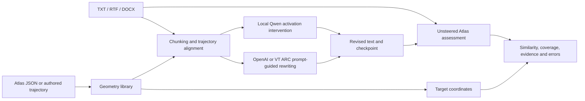

# AFFECTOR: Emotional Geometry Transfer through Transformer Activation Steering

**William Taggart**

Modern and Classical Languages and Literatures, Virginia Tech

Email: wtaggart@vt.edu

**Technical report · November 12, 2026 · Implementation version 0.1.0**

## Abstract

AFFECTOR is an experimental macOS application for transforming writing according to emotional trajectories generated by Emotional Atlas or authored directly by a user. It implements two distinct transformation paths: local hidden-state intervention in a frozen Qwen3.5-0.8B model, and prompt-guided rewriting through OpenAI or Virginia Tech Advanced Research Computing (VT ARC) APIs. The local method converts three-dimensional emotional coordinates into coefficients over contrastively estimated activation vectors. A bounded perturbation modifies both the feed-forward input and residual path at selected transformer blocks. Independent assessment compares original and revised passages with the requested coordinates using the Emotional Atlas scoring prompt and validation rules. The application supports portable geometry files, editable module weights, text document import/export, checkpointing, and continuation after individual failures. Tests establish several implementation properties, including zero-strength output equivalence and hook cleanup. They do not establish reliable emotional shape transfer, semantic preservation, or multilingual effectiveness.

## 1. Scope and research objective

The objective is to transfer an emotional progression from one text to another while maintaining a recognizable connection to the target text's subject and situation. Emotional Atlas supplies interpretive coordinates for valence, emotional direction, and intensity. AFFECTOR treats these as a trajectory indexed by progress through a document.

The implemented geometric object is this ordered trajectory. The system does not fit a solid mesh, preserve a surface topology, or optimize a four-dimensional volume. Its position coordinate supplies a temporal ordering rather than a fourth independently steered emotional axis. AFFECTOR can import Atlas object and evolution exports when their metadata retains the underlying emotional analysis; bare mesh or PCA coordinates are insufficient to recover the semantic axes.

The interface follows a monochrome visual style inspired by FENNEC and includes persistent light/dark appearance settings. Native SwiftUI views separate document transformation, geometry and weight editing, and verification.

## 2. System architecture



A private JSON-lines subprocess bridge connects the native application to the Python engine. No local web server is required. The bridge serializes long-running operations; generation and assessment execute outside the UI thread. The local model uses PyTorch on Apple's MPS device when available, with CPU fallback. The packaged development app includes its interpreter, libraries and model. The public source repository excludes that large runtime and the application bundle.

Key implementation files are:

| Component | Source |
|---|---|
| Native interface and appearance | [`macos/Affector.swift`](../macos/Affector.swift) |
| Operation orchestration and checkpoints | [`engine/bridge.py`](../engine/bridge.py) |
| Geometry validation, interpolation and library | [`engine/geometry.py`](../engine/geometry.py) |
| Calibration, activation module and model hooks | [`engine/steering.py`](../engine/steering.py) |
| API requests and coordinate comparison | [`engine/providers.py`](../engine/providers.py) |
| Atlas scoring prompt, schema and validation | [`engine/atlas_analysis.py`](../engine/atlas_analysis.py) |
| Document conversion and chunk assembly | [`engine/documents.py`](../engine/documents.py) |

## 3. Emotional representation and alignment

A geometry stores points $(t,v,d,i)$ with position $t\in[0,1]$, valence $v\in[-1,1]$, direction $d\in[-1,1]$, and intensity $i\in[0,1]$. Negative direction represents inward/self-focused emotion; positive direction represents emotion directed toward others or the world. Direction is not synonymous with positive or negative valence.

The steering coordinate uses the Atlas plot convention:

$$c(t)=(v(t),d(t),2i(t)-1).$$

Coordinates are linearly interpolated between stored points, with endpoints clamped. Atlas positions with unsupported direction are omitted rather than assigned a fabricated direction. The remaining trajectory interpolates across those gaps, a limitation recorded in import provenance.

Documents are divided into chunks of at most 700 characters, preferring available whitespace boundaries. Given a chunk's original character offsets $a,b$ and total input length $N$, its trajectory position is $(a+b)/(2N)$. The target remains constant while that chunk is generated. No token-level progression through the source trajectory occurs within a chunk. Adjacent chunks are rewritten independently; neighboring document text is not supplied as a continuity context.

## 4. Contrastive activation calibration

The local backend uses `Qwen/Qwen3.5-0.8B`, pinned to revision `2fc06364715b967f1860aea9cf38778875588b17`. The text stack has 24 blocks and hidden width 1,024. The engine uses float32, eager attention, frozen base parameters, inference mode, and a chat template with thinking disabled. Model architecture and upstream licensing are described in the [official model card](https://huggingface.co/Qwen/Qwen3.5-0.8B).

Calibration uses twelve manually authored English contrast pairs: four per emotional axis. These contrast unpleasant/pleasant affect, inward/outward focus, and low/high intensity. Every member is processed under a fixed instruction to continue in the same emotional voice, producing 24 forward passes. At each selected layer, the code captures the final prompt position immediately before the post-attention normalization feeding the feed-forward network. Because a generation prefix is appended, the capture is from the chat-formatted final position, not an average of passage-token activations.

For layer $\ell$ and axis $j$, the raw direction is:

$$u_{\ell,j}=\frac{1}{4}\sum_{k=1}^{4}(h^+_{\ell,j,k}-h^-_{\ell,j,k}).$$

It is normalized using:

$$b_{\ell,j}=\frac{u_{\ell,j}}{\max(\operatorname{RMS}(u_{\ell,j}),10^{-8})},\qquad
\operatorname{RMS}(x)=\sqrt{\frac{1}{1024}\sum_{r=1}^{1024}x_r^2}.$$

The three directions form a matrix $B_\ell\in\mathbb{R}^{3\times1024}$. These are the editable module weights. Default layers are 8, 16 and 23, indexed from zero, with respective weights 1, 1 and 0.5. Geometry files preserve the matrices, calibration pairs, model revision and runtime identity. Incompatible identities are rejected at hook installation.

There is no backpropagation, supervised regression against Atlas scores, orthogonalization, or outcome-driven selection of the directions. The pairs can confound their intended axis with emotional category, subject matter or other linguistic changes. Repeating the same deterministic calibration does not constitute learning from a user's document.

## 5. Steering coefficients, strength, inertia and budget

For each axis, activation temperature $T$ reshapes the target coefficient:

$$a_j=\operatorname{sign}(c_j)|c_j|^{1/T}m_j.$$

The mask $m$ keeps axes in descending order of $|c_j|^{1/T}$. Selection stops after activation top-k axes or when the cumulative selected magnitude reaches the requested activation mass fraction. The threshold-crossing axis is included. These controls act on three emotional axes, not vocabulary tokens, and retained coefficients are not renormalized. Defaults $T=1$, top-k $=3$, mass $=1$ preserve all target coefficients.

At a selected layer and decoding step, let $h$ be the current final-token state after the attention portion of the block. The raw perturbation is:

$$r_{\ell,n}=s\,w_\ell\operatorname{RMS}(h_{\ell,n})(aB_\ell),$$

where $s$ is strength and $w_\ell$ is the layer weight. Default strength is 0.12.

For inertia $\rho$, the first step uses $\tilde\delta=r$. Later steps use:

$$\tilde\delta_{\ell,n}=\rho\delta_{\ell,n-1}+(1-\rho)r_{\ell,n}.$$

With budget $\beta$, the applied perturbation is:

$$\delta_{\ell,n}=\tilde\delta_{\ell,n}
\min\left(1,\frac{\beta\operatorname{RMS}(h_{\ell,n})}{\max(\operatorname{RMS}(\tilde\delta_{\ell,n}),10^{-12})}\right).$$

The previous applied, already capped perturbation is retained for the next step. Inertia and budget both default to 0.20. Module instances are recreated per chunk, so inertia does not carry across chunks. Zero strength, zero budget or zero layer weight returns an exactly zero perturbation.

Budget is a per-layer bound on vector RMS, not a bound on each component, token probabilities, downstream model amplification, or percentage of text changed. Inertia smooths numerical adjustments across decoding steps; because the chunk target is constant, it primarily smooths changes driven by hidden-state scale.

## 6. Transformer insertion and relation to LAMP-Qwen

The feed-forward portion of the unmodified block has the residual form:

$$y=h+\operatorname{FFN}(\operatorname{Norm}(h)).$$

AFFECTOR implements:

$$\boxed{y=(h+\delta)+\operatorname{FFN}(\operatorname{Norm}(h+\delta)).}$$

A forward pre-hook on `post_attention_layernorm` adds the perturbation to the feed-forward input. A forward hook on the decoder block adds the same perturbation to the residual output. The second addition supplies the residual change; it does not add a second independent steering vector to the same branch. The implementation uses the [PyTorch module hook interfaces](https://docs.pytorch.org/docs/2.15/generated/torch.nn.Module.html).

During prompt prefill, only the final position is modified. During cached autoregressive decoding, the current position is modified at every selected layer. Earlier prompt positions are not rewritten by these hooks. All handles are removed in a `finally` block, including after exceptions.

This placement follows the pre-FFN and residual intervention used in the local LAMP-Qwen prototype. The mechanism supplying the perturbation differs: AFFECTOR has no associative recognition key, lexical trigger or memory retrieval gate. Its trajectory coefficients continuously control the selected layers. The present work does not reproduce or claim LAMP's empirical findings.

The local rewriting prompt requests fluent prose retaining the main subject and recognizable situation, while allowing changes in phrasing, imagery and emotional expression. It contains no emotional coordinates. Standard decoding temperature, top-p and top-k remain separate from activation controls; temperature zero uses greedy decoding.

## 7. A consequential limitation: target bias rather than error correction

The module mixes vectors using the absolute target coordinate. It does not estimate the current chunk's emotional state before rewriting and does not compute a target-minus-current emotional error.

Consequently, target valence zero produces no valence perturbation, even if the input is strongly negative. Target intensity 0.5 becomes a zero intensity coefficient and does not actively reduce or increase the input toward moderate intensity. A larger strength can change the output without making it closer to the target. There is no automatic verification-driven revision loop.

The method is therefore an activation-bias prototype, not a demonstrated inverse mapping from emotional geometry to language. This limitation is central when interpreting weak or inconsistent transformations.

## 8. API alternative

OpenAI rewriting uses Responses requests with `store:false`; VT ARC rewriting uses an OpenAI-compatible chat endpoint. API mode supplies desired coordinates as instructions alongside the target passage. It does not install a transformer module, expose hidden states, or apply the local activation controls. The output-token limit applies to both paths. Users choose model identifiers and supply their own credentials.

These adapters were implemented and exercised with mocked failures; live authenticated provider calls were not part of the recorded validation. Provider availability and model access depend on the user's account. API keys are held in process memory and excluded from saved geometries, checkpoints and reports. API passages leave the machine for the selected provider; local mode uses the bundled model.

## 9. Verification against Emotional Atlas

The evaluator is independently selectable. Original and revised chunks are assessed without activation hooks using the Atlas prompt, schema, direction consistency checks and exact-source evidence validation. These checks establish response structure and traceability, not the correctness of an emotional interpretation.

For a valid scored coordinate $p$ and requested coordinate $c$:

$$D(p,c)=\frac{\|p-c\|_2}{2\sqrt3},\qquad S(p,c)=1-D(p,c).$$

The denominator is the full diagonal of the Atlas cube $[-1,1]^3$. Similarity is in $[0,1]$ and is not a probability. Per-axis absolute errors are also exported, with intensity expressed on the scaled plot axis. Summary improvement is the mean revised similarity minus the mean original similarity, calculated only over paired valid assessments. Coverage is paired valid chunks divided by all document chunks.

Failed assessments and unsupported directions are excluded rather than replaced with zeros. Original-retained rewrites remain visible in the report. The score measures target proximity, not semantic preservation, factual accuracy, literary merit, or an independently established psychological property. Use of the same small model for generation and evaluation introduces correlated-error risk; an independent evaluator can help but does not remove the interpretive nature of the coordinates.

## 10. Failure handling, persistence and document fidelity

Each assessment receives one attempt. Invalid output, timeouts, API failures and incidental interruptions are recorded at chunk/assessment level, and the run proceeds. A failed rewrite retains the original chunk. An explicit user Stop still cancels the run. Model initialization, calibration, invalid geometry and checkpoint-storage failures are run-level conditions rather than ordinary chunk failures.

Local generation has a 120-second budget checked between decoding steps. This is not a hard interrupt of a blocking kernel or model initialization. In-flight API calls can wait until their network timeout before cancellation takes effect. Failed requests may already have consumed provider usage.

Completed chunks are checkpointed through atomic JSON replacement. A signature of input text, geometry, backend, model and sampling settings controls reuse on resume. Geometry files and transfer files preserve editable settings; transfer checkpoints include the full source and output text and should be handled accordingly.

TXT, RTF and DOCX import/export support plain textual content. Rich formatting, tracked changes and embedded media are not preserved. Assembly preserves original inter-chunk separators, while rewritten chunk contents can change. The application provides manual checkpoint saving, geometry import/export/deletion and JSON report export.

## 11. Validation and evidence

On November 12, 2026, all **11 automated tests** passed. They cover geometry import/validation, similarity endpoints, document round trips, library operations, checkpoint reuse and credential exclusion, failed-chunk continuation, explicit Stop, and single-attempt assessment behavior. The transport tests cover connection, timeout, incidental interruption and provider request errors. These tests are contained in [`tests`](../tests).

A recorded real-model smoke test on MPS additionally checked:

- Identical greedy text with zero strength and without steering.
- Nonzero hook injections during a steered rewrite.
- Disabled gradients on all base model parameters.
- Hook removal after generation.
- Restoration of baseline output after steering.
- Enforcement of the perturbation RMS budget.

For the synthetic kitchen-table letter passage, the baseline produced 69 tokens; a steered run at strength 0.25 and target $(0.8,0.5,0.5)$ produced 29 tokens with 90 recorded layer injections and mean injected RMS approximately 0.02768. The steered output introduced “her heart racing.” These observations demonstrate a numerical intervention and an output difference, not successful geometric matching. `activation_injections` counts nonzero layer-position interventions, not emotionally changed words. No parameter hash comparison was performed; the frozen-parameter test checks `requires_grad`, supplemented by baseline restoration.

The historical result is preserved in [`artifacts/model-smoke.json`](../artifacts/model-smoke.json). Its local assessment used the earlier two-attempt correction policy and passed after correction. **It does not demonstrate success under the current one-attempt policy.** The latest single-attempt behavior is covered by dedicated regression tests. The stored calibration file has default control settings; the smoke-test script explicitly changes strength to 0.25 for its steered generation.

No held-out corpus study, multilingual benchmark, semantic-fidelity evaluation, human rating study, or statistical comparison of steering strengths has been completed. Runtime measurements are illustrative single-machine observations, not performance guarantees. User observations of weak transformation remain consistent with these limitations.

## 12. Reproduction, packaging and next experiments

The tested runtime uses Python 3.14, PyTorch 2.15.0 and Transformers 5.22.2. Complete dependency pins are in [`requirements-lock.txt`](../requirements-lock.txt). The native package targets Apple Silicon and macOS 26+. It is locally ad-hoc signed and has not been notarized for public distribution.

The build script consumes an existing relocated runtime through `AFFECTOR_RUNTIME`; its development default points to the local LAMP-Qwen application resources. It copies numerical libraries, model files and dependency notices, not LAMP associative memories. A clean machine must provide that runtime layout before using the script. The repository is source and documentation, not a turnkey installer, and contains neither the model checkpoint nor the packaged app.

Run the ordinary test suite with a Python environment matching the dependency pins:

```sh
python -m unittest discover -s tests -p 'test_*.py' -v
```

The real-model check additionally needs the pinned model cached locally, discoverable through `HF_HOME`, or supplied through `AFFECTOR_MODEL`:

```sh
python tests/model_smoke.py
```

Priority follow-up experiments are to compare opposite targets under fixed decoding; build larger, better-controlled contrast sets; fit steering coefficients against measured Atlas outcomes; examine layer-specific effects and axis interference; and test target-minus-current corrections. Quality evaluation should report coverage, negative results, semantic changes and uncertainty alongside similarity improvement. These are proposed experiments, not implemented capabilities.

## References and provenance

1. [Emotional Atlas source repository](https://github.com/FL2744/Emotional-Atlas): emotional coordinate framework and copied scoring/validation components. The retained MIT notice is [`ATLAS_LICENSE`](../ATLAS_LICENSE).
2. [Qwen3.5-0.8B official model card](https://huggingface.co/Qwen/Qwen3.5-0.8B): model specification and Apache-2.0 licensing. The implementation pins the revision listed above.
3. [PyTorch Module documentation](https://docs.pytorch.org/docs/2.15/generated/torch.nn.Module.html): forward and forward-pre hooks used to install the intervention.
4. LAMP-Qwen local prototype: architectural precedent for paired pre-FFN/residual intervention. Its recognition and memory mechanism is not included in AFFECTOR.
5. [FENNEC](https://l1001.vt.domains/fennec.html): interface styling reference.

This report describes the implementation and recorded development evidence available on the date above. It makes no claim of peer review or validated emotional control.

## AI assistance disclosure

This project was created with assistance from GPT-6 Astra and Codex. AI tools supported software development, testing, and the drafting and revision of this technical report. William Taggart is responsible for the project's research decisions and the final software and documentation. AI assistance does not constitute independent validation of the implementation or its scientific claims; the validation evidence and limitations are stated separately in this report.
